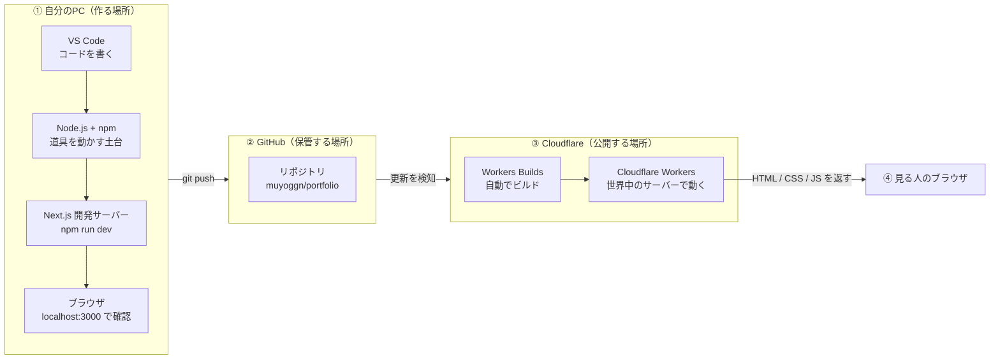
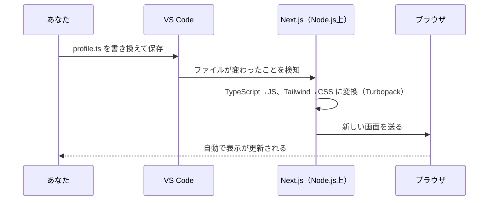
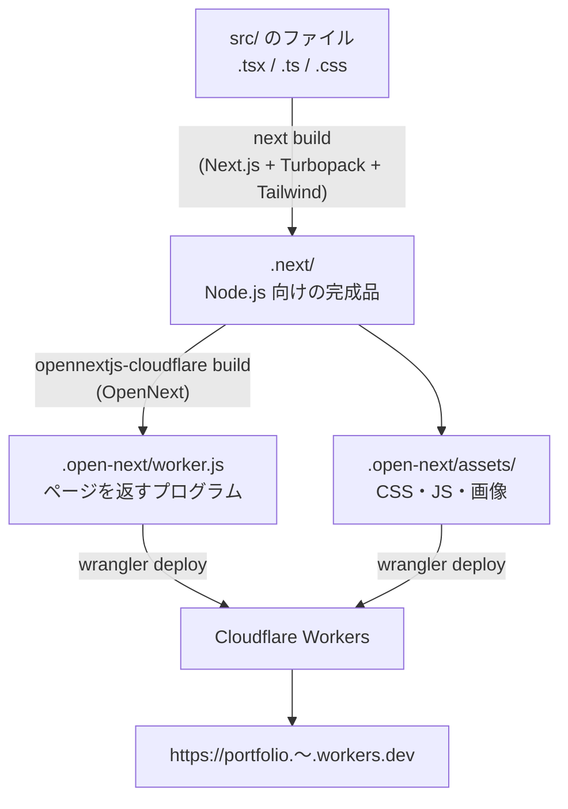
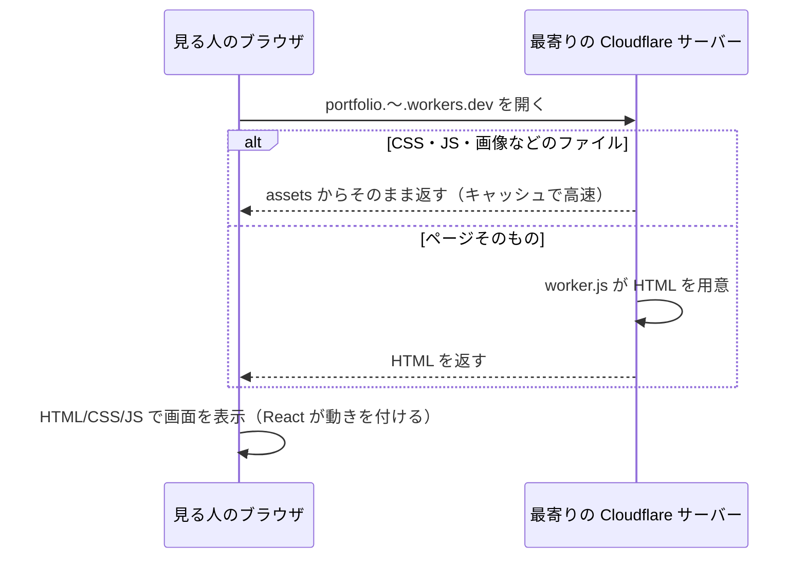

# このサイトの技術構成（全体図と、ひとつひとつの役割）

このポートフォリオを作るのに使っている言語・フレームワーク・ツール・サービスを、
「それは何か」と「このサイトでどんな仕事をしているか」の両方から説明するノートです。
用語のごく短い説明は [GUIDE.md](GUIDE.md) の「2. 用語の解説」にもあります。こちらは **つながり（構造）** に重点を置いています。

---

## 1. まず全体を一枚で

サイトができてから人に見られるまでには、大きく **4つの場所** が関わっています。



| 場所 | 一言でいうと | 主な登場人物 |
|---|---|---|
| ① 自分のPC | 工房。作って、試す | VS Code、Node.js、npm、Next.js、TypeScript、React、Tailwind、ESLint、Git |
| ② GitHub | 倉庫。完成品と作業記録を保管 | Git、GitHub |
| ③ Cloudflare | お店。お客さんに出す | OpenNext、Wrangler、Cloudflare Workers |
| ④ 見る人のブラウザ | お客さん | HTML・CSS・JavaScript だけを受け取る |

**大事なポイント：** ブラウザが理解できるのは最後まで **HTML・CSS・JavaScript の3つだけ** です。
TypeScript も React も Tailwind も、すべて「その3つを楽に・安全に作るための道具」で、公開前に3つへ変換されます。

---

## 2. 道具を「層（レイヤー）」で見る

上にあるものほど、あなたが直接書くもの。下にあるものほど、裏で支えているものです。

```
┌─────────────────────────────────────────────────────────────┐
│ あなたが書くもの     profile.ts / page.tsx / globals.css       │ ← 中身
├─────────────────────────────────────────────────────────────┤
│ 言語                 TypeScript（＋JSX） / CSS                 │ ← 書き方
├─────────────────────────────────────────────────────────────┤
│ 見た目・部品         React（部品） / Tailwind CSS（見た目）     │ ← 道具
├─────────────────────────────────────────────────────────────┤
│ サイトの枠組み       Next.js（ページ・URL・変換の司令塔）        │ ← 枠組み
├─────────────────────────────────────────────────────────────┤
│ 品質チェック         TypeScript の型チェック / ESLint           │ ← 検査係
├─────────────────────────────────────────────────────────────┤
│ 動かす土台           Node.js / npm（package.json）             │ ← 電源・倉庫
├─────────────────────────────────────────────────────────────┤
│ 記録・保管           Git（PC内の記録） / GitHub（ネット上の倉庫）│ ← 履歴
├─────────────────────────────────────────────────────────────┤
│ 公開                 OpenNext → Wrangler → Cloudflare Workers  │ ← お店
└─────────────────────────────────────────────────────────────┘
```

---

## 3. ひとつずつ詳しく

各項目は「**何者か**」「**このサイトでの仕事**」「**どこに出てくるか**」の順で書いています。

### 3-1. 言語（コードを書くための「ことば」）

#### HTML / CSS / JavaScript
- **何者か**：Web の基本の3つ。HTML＝骨組み、CSS＝見た目、JavaScript＝動き。
- **このサイトでの仕事**：最終的にブラウザへ届く「完成品」。あなたが直接書くのは CSS の一部だけで、HTML と JavaScript は Next.js が作ってくれます。
- **どこに出てくるか**：`src/app/globals.css`（CSS）。HTML/JS はビルド後に `.next/` や `.open-next/` の中に生成されます（Git には入れていません）。

#### TypeScript（`.ts` / `.tsx`）
- **何者か**：JavaScript に「型（データの形のルール）」を足した言語。Microsoft が作っています。書いたものは JavaScript に変換されて動きます。
- **このサイトでの仕事**：「作品には title と description が必ずある」などのルールを決めておき、書き間違いを **公開前に** 見つけます。
- **どこに出てくるか**：`src/` の中のほぼ全部。`src/data/profile.ts` の `type Work = {...}` が型の例。設定は `tsconfig.json`（`"strict": true` で厳しめにチェック、`@/` を `src/` の近道にする設定など）。
- **補足 `.tsx` と JSX**：`.tsx` は「TypeScript の中に HTML っぽい書き方（JSX）を混ぜてよい」ファイル。`<h1>{profile.name}</h1>` のように書けるのは JSX のおかげです。

### 3-2. 見た目と部品

#### React（リアクト）
- **何者か**：Meta（旧 Facebook）が作った、画面を **部品（コンポーネント）** で組み立てるための **ライブラリ**。
- **このサイトでの仕事**：ヘッダーや「見出し＋中身」の枠を部品にして使い回しています。データ（`profile.ts`）を渡すと、それに合わせて画面を作ります。
- **どこに出てくるか**：`src/components/Header.tsx`、`src/components/Section.tsx`。`package.json` の `react` と `react-dom`（React の画面をブラウザの HTML に反映する係）。

#### Tailwind CSS v4（テイルウィンド）
- **何者か**：`className="text-xl font-bold"` のように **クラス名を並べるだけでデザインできる** CSS の道具。
- **このサイトでの仕事**：すべての見た目（余白・文字の大きさ・色・スマホ対応）を担当。使ったクラスだけを集めて、小さな CSS ファイルを自動で作ってくれます。
- **どこに出てくるか**：各 `.tsx` の `className="..."`。`globals.css` の `@import "tailwindcss";` と `@theme`（自分の色 `accent` などを Tailwind のクラス名として使えるようにする設定）。`next.config.ts` の `@tailwindcss/turbopack` は「Next.js の変換係に Tailwind を組み込む」ための接続部品です。

#### Google Fonts（Noto Sans JP / Geist Mono）
- **何者か**：Google が無料で配っているフォント集。
- **このサイトでの仕事**：日本語をきれいに表示（Noto Sans JP）、英数字のコード風表示（Geist Mono）。
- **どこに出てくるか**：`src/app/layout.tsx` の `next/font/google`。Next.js がビルド時にフォントを取り込むので、見る人のブラウザが毎回 Google に取りに行く必要がありません。

### 3-3. サイトの枠組み

#### Next.js 16（ネクスト・ジェイエス）
- **何者か**：Vercel 社が作っている、React で **サイト全体** を作るための **フレームワーク**。
- **このサイトでの仕事**：いわば **司令塔**。
  - **URL の決定**：`src/app/page.tsx` → `/`（ファイルの置き場所がそのまま URL）
  - **共通の外枠**：`src/app/layout.tsx` が全ページの `<html>` `<body>` を担当
  - **変換**：TypeScript・JSX・Tailwind をまとめて、ブラウザ用の HTML/CSS/JS に変換（ビルド）
  - **開発サーバー**：`npm run dev` で、保存するたびに画面が自動更新される仕組みを提供
  - **最適化**：フォント・画像の最適化、ページの事前生成で表示を速くする
- **どこに出てくるか**：`next.config.ts`（設定）、`src/app/`（ページ）、`package.json` の `next`。
- **補足 Turbopack**：Next.js に内蔵された「変換エンジン（バンドラー）」。たくさんのファイルを高速に変換・ひとまとめにします。`next.config.ts` の `turbopack:` はその設定です。

### 3-4. 品質チェック

#### ESLint（イーエスリント）
- **何者か**：コードの「よくある間違い」や「おすすめされない書き方」を指摘してくれる **検査ツール**。
- **このサイトでの仕事**：Next.js 公式のルール集（`eslint-config-next`）で、表示速度に悪い書き方や React のミスを指摘します。
- **どこに出てくるか**：`eslint.config.mjs`、`npm run lint` で実行。VS Code に拡張機能を入れると、書いている最中に波線で教えてくれます。

#### `@types/...`
- **何者か**：「Node.js や React にはこういう機能がある」という **型の説明書**。
- **このサイトでの仕事**：TypeScript が React などを正しくチェックできるようにする。実際の画面には何も影響しません。

### 3-5. 動かす土台

#### Node.js（ノード）
- **何者か**：本来ブラウザの中でしか動かない JavaScript を、**PC やサーバーの上で動かすためのソフト**。
- **このサイトでの仕事**：Next.js、ESLint、Wrangler など、この表の「道具」はすべて JavaScript 製なので、Node.js がないと1つも動きません。**全部の道具の電源** のような存在です。

#### npm（エヌピーエム）と package.json
- **何者か**：Node.js に付いてくる **道具の取り寄せ係（パッケージマネージャー）**。世界中の人が公開しているライブラリを、インターネットの倉庫（npm レジストリ）からダウンロードします。
- **このサイトでの仕事**：
  - `package.json` の **`dependencies`**（サイトの実行に必要なもの：next, react, react-dom, @opennextjs/cloudflare）と **`devDependencies`**（作るときだけ必要なもの：typescript, tailwindcss, eslint, wrangler など）を見て、`npm install` で `node_modules/` に全部取り寄せます。
  - `package.json` の **`scripts`** に「よく使う操作のあだ名」を登録しています。`npm run dev` は実際には `next dev` を実行しています。
  - `package-lock.json` は「取り寄せたバージョンの正確な記録」。誰がいつ `npm install` しても同じ状態になるようにするためのものです。

| あなたが打つコマンド | 中で実際に動くもの | 何が起きるか |
|---|---|---|
| `npm run dev` | `next dev` | 開発サーバー起動。保存すると即反映 |
| `npm run build` | `next build` | 公開用に変換できるか確認 |
| `npm run lint` | `eslint` | コードの検査 |
| `npm run preview` | `opennextjs-cloudflare build` → `preview` | Cloudflare と同じ仕組みで手元確認 |
| `npm run deploy` | `opennextjs-cloudflare build` → `deploy` | Cloudflare に公開 |

### 3-6. 記録と保管

#### Git（ギット）
- **何者か**：ファイルの **変更履歴を記録するソフト**。PC の中で動きます。
- **このサイトでの仕事**：「いつ・何を・なぜ変えたか」をセーブポイント（**コミット**）として残します。失敗しても前の状態に戻せます。
- **どこに出てくるか**：`.git/` フォルダ（履歴の本体。触らない）、`.gitignore`（記録しないものの一覧。`node_modules/` や `.next/` のような自動生成物、`.dev.vars` のような秘密情報など）。

#### GitHub（ギットハブ）
- **何者か**：Git の履歴を **インターネット上に保管・共有するサービス**（Microsoft 傘下）。
- **このサイトでの仕事**：
  1. **バックアップ**：PC が壊れてもコードが残る
  2. **就活のアピール**：https://github.com/muyoggn/portfolio で、どう作ってきたかを見せられる
  3. **公開の起点**：GitHub に **push（送信）** すると、それを合図に Cloudflare が自動で公開し直す
- **補足 ブランチ・プルリクエスト**：本番の `main` とは別の「作業用の枝（ブランチ）」で変更し、問題なければ `main` に取り込む（**プルリクエスト／PR**）、という進め方をします。詳しくは [GITHUB.md](GITHUB.md)。

### 3-7. 公開

ここが一番わかりにくいところなので、先に理由を説明します。

> Next.js は本来「Node.js が動くサーバー」で動く前提で作られています。
> ところが Cloudflare Workers は Node.js とは **少し違う、軽量な実行環境** です。
> そこで **OpenNext が「Cloudflare 用に詰め直す」**、**Wrangler が「Cloudflare に届ける」** という分担になっています。

#### @opennextjs/cloudflare（OpenNext／オープンネクスト）
- **何者か**：Next.js で作ったサイトを、Vercel 以外のサービスで動かせる形に **変換するツール**。その Cloudflare 版。
- **このサイトでの仕事**：`next build` の結果を受け取り、
  - `.open-next/worker.js`：リクエストを受けてページを返す **プログラム本体**
  - `.open-next/assets/`：画像・CSS・JS など **そのまま配ればよいファイル**

  の2つに分けて詰め直します。
- **どこに出てくるか**：`open-next.config.ts`（変換の設定。今は初期設定のまま）、`next.config.ts` の最後の行（`npm run dev` 中も Cloudflare の機能を使えるようにする接続）。

#### Wrangler（ラングラー）
- **何者か**：Cloudflare 公式の **コマンドラインツール**。Workers を手元で試したり、Cloudflare にアップロードしたりします。
- **このサイトでの仕事**：OpenNext が作ったものを Cloudflare に届けます（`npm run deploy` の中で動く）。`npm run preview` では Cloudflare と同じ環境（workerd）を手元に再現します。
- **どこに出てくるか**：`wrangler.jsonc`（Cloudflare 側の設定書）
  - `name: "portfolio"` … Cloudflare 上での名前。URL の `portfolio.〜.workers.dev` になる
  - `main` … 動かすプログラム（`.open-next/worker.js`）
  - `assets` … そのまま配るファイルの場所
  - `compatibility_flags: ["nodejs_compat"]` … Node.js の機能の一部を Workers でも使えるようにする
  - `images` … 画像の最適化を Cloudflare にやってもらう
- `public/_headers`：「`/_next/static/` のファイルは1年間キャッシュしてよい」と Cloudflare に伝える設定。再訪問時の表示が速くなります。
- `.dev.vars`：手元でだけ使う秘密の設定値を置くファイル（Git には入れない）。

#### Cloudflare Workers（ワーカーズ）
- **何者か**：Cloudflare が世界中に持っているサーバー（300 以上の都市）で、プログラムを動かせるサービス。サーバーの管理は Cloudflare 任せでよく、無料枠があります。
- **このサイトでの仕事**：見る人がアクセスすると、**その人に一番近い** Cloudflare のサーバーが `worker.js` を動かしてページを返します。だから世界中どこからでも速く表示されます。
- **補足 Workers Builds**：GitHub と Cloudflare をつないでおくと、push のたびに Cloudflare 側で `opennextjs-cloudflare build` → `deploy` を自動でやってくれる機能です（手順は [GUIDE.md](GUIDE.md) の 8 章）。

### 3-8. 作業を助けるもの

| 名前 | 何者か | このサイトでの仕事 |
|---|---|---|
| **VS Code** | Microsoft の無料コードエディタ | コードを書く。TypeScript や ESLint のエラーをその場で表示 |
| **ターミナル** | 文字でPCに命令する画面 | `npm run dev` や `git` コマンドを打つ場所 |
| **ブラウザ** | Chrome / Safari など | 完成品を見る。`localhost:3000` は「自分のPCの中の 3000 番の窓口」という意味 |
| **Claude** | Anthropic の AI アシスタント | 設計・コード作成・説明・GitHub への push の手伝い。このノートも Claude が書いています |

---

## 4. 「書いてから見られるまで」を順番に追う

### 4-1. 手元で確認するとき（`npm run dev`）



### 4-2. 公開するとき（ビルド → デプロイ）



### 4-3. 誰かがサイトを開いたとき



---

## 5. ファイルと道具の対応表

| ファイル | 担当の道具 | 触る？ |
|---|---|---|
| `src/data/profile.ts` | TypeScript | ★ よく触る（中身の文章） |
| `src/app/page.tsx` | Next.js + React + Tailwind | レイアウトを変えるとき |
| `src/app/layout.tsx` | Next.js（全ページ共通の外枠） | たまに |
| `src/app/globals.css` | Tailwind / CSS | 色を変えるとき |
| `src/components/*.tsx` | React | 部品を増やすとき |
| `public/` | Next.js（そのまま配るファイル置き場） | 画像を置くとき |
| `package.json` / `package-lock.json` | npm | ライブラリを追加するとき（`npm install 名前` で自動更新） |
| `tsconfig.json` | TypeScript | 基本触らない |
| `eslint.config.mjs` | ESLint | 基本触らない |
| `next.config.ts` | Next.js | 基本触らない |
| `open-next.config.ts` | OpenNext | 基本触らない |
| `wrangler.jsonc` / `public/_headers` | Wrangler / Cloudflare | 基本触らない |
| `.gitignore` | Git | 基本触らない |
| `AGENTS.md` | AI アシスタント向けのメモ（Next.js が自動で書く） | 触らない |
| `node_modules/` `.next/` `.open-next/` | 自動生成物 | 触らない・Git に入れない |

---

## 6. まとめ（ひとことで）

- **TypeScript** で書き、**React** で部品にし、**Tailwind** で見た目を付ける
- それを **Next.js** がサイトとして組み立て、HTML/CSS/JS に変換する
- これらの道具はすべて **Node.js** の上で動き、**npm** が取り寄せる。**ESLint** と型チェックが間違いを見張る
- 変更は **Git** で記録し、**GitHub** に保管する
- **OpenNext** が Cloudflare 用に詰め直し、**Wrangler** が届け、**Cloudflare Workers** が世界中に配る
