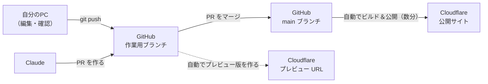

# 更新を GitHub と Cloudflare に反映する手順（場面別）

サイトの中身を変えたあと、「GitHub に保存する」「公開サイトに反映する」ための手順を、場面ごとにまとめたページです。
迷ったら、まず下の「全体の流れ」を見て、自分が今どの場面にいるかを確かめてください。

> コマンドは Mac の「ターミナル」で、`portfolio` フォルダ（例：`~/Desktop/portfolio`）に移動してから打ちます。
> 移動は `cd ~/Desktop/portfolio` です。

---

## 1. 全体の流れ（3つの場所）

サイトのコードは、次の3つの場所にあります。

| 場所 | 役割 | 見え方 |
|---|---|---|
| **自分のPC** | 実際にファイルを書き換える作業場 | `npm run dev` で http://localhost:3000 |
| **GitHub** | コードの保管庫と変更履歴 | https://github.com/muyoggn/portfolio |
| **Cloudflare** | インターネットに公開するサーバー | `https://portfolio.〇〇.workers.dev` |

そして、いちばん大事なルールはこれです。

> **GitHub の `main` ブランチに入ったものが、自動で公開サイトになる。**

Cloudflare は GitHub と連携していて（**Workers Builds** という機能）、`main` が変わると自動でビルド（公開用に変換）してデプロイ（公開）します。なので、普段は Cloudflare を直接さわる必要はありません。



### 覚えておく言葉

| 言葉 | 意味 |
|---|---|
| ブランチ（branch） | 履歴の「枝分かれ」。本番の `main` を汚さずに、別の枝で試しに変更できる |
| `main` | 本番用のブランチ。ここに入ったものが公開される |
| PR（プルリクエスト） | 「この枝の変更を `main` に入れていいですか？」というお願い。GitHub 上で差分を見られる |
| マージ（merge） | PR の変更を `main` に取り込むこと。**これが「公開して OK」のボタン** |
| ビルド / デプロイ | 公開用に変換すること / サーバーに載せて公開すること |
| コミット / プッシュ | 変更をセーブポイントとして記録すること / それを GitHub に送ること |

---

## 2. 場面A：Claude が PR を作ったとき（いちばんよくある場面）

Claude に「ここを直して」と頼むと、Claude は作業用ブランチに変更を入れて **PR** を作ります。
**PR はマージするまで公開サイトには出ません。** 「直したと言われたのに変わっていない」の原因は、たいていこれです。

1. Claude が貼った PR のリンク（`https://github.com/muyoggn/portfolio/pull/番号`）を開く
2. 「Files changed」タブで、何が変わったかをざっと見る（全部わからなくて大丈夫）
3. 見た目を先に確かめたいときは、下の **場面B** へ
4. 問題なければ、ページ下の緑の **「Merge pull request」** →**「Confirm merge」** を押す
5. 2〜5分ほど待ってから、公開サイトを開いて再読み込みする（`Cmd + Shift + R`）
6. 最後に、自分のPCも最新にしておく（次に自分で編集するときに古いままにならないように）

   ```bash
   git checkout main
   git pull
   ```

> マージ後に「Delete branch」ボタンが出たら、押して大丈夫です（作業用の枝を片付けるだけで、変更は `main` に残ります）。

---

## 3. 場面B：マージする前に見た目を確かめたいとき

方法は2つあります。

### 方法1：自分のPCで動かす（確実）

PR のページ上部に `muyoggn wants to merge ... from claude/project-thread-xxxx` と書いてあります。この `claude/project-thread-xxxx` がブランチ名です。

```bash
git fetch                              # GitHub の最新の情報を取ってくる
git checkout claude/project-thread-xxxx  # その枝に切り替える
npm install                            # 新しいライブラリが増えていても大丈夫なように
npm run dev                            # http://localhost:3000 で確認
```

確認が終わったら `Ctrl + C` で止めて、`git checkout main` で本番の枝に戻ります。

### 方法2：Cloudflare のプレビュー URL で見る（スマホでも見られる）

Cloudflare は、`main` 以外のブランチが更新されたときも、**公開サイトとは別のお試し版（プレビュー）** を作ってくれます。

- PR のページ下の方にある「Workers Builds: portfolio」の行に ✓（緑）が付いていれば成功です。「Details」から Cloudflare の画面に移れます
- 成功すると、PR にプレビュー URL がコメントで付くことがあります。付かない場合は、Cloudflare の「Workers & Pages」→ `portfolio` →「Deployments」（デプロイ）でそのバージョンを開くと URL が見られます
- ✗（赤）のときはプレビューが作れていません。下の **場面E** を見てください

---

## 4. 場面C：自分のPCでファイルを編集したとき

### 編集を始める前に（毎回）

まず最新の状態にしてから書き換えます。古いまま編集すると、あとで食い違い（コンフリクト）が起きやすくなります。

```bash
git checkout main
git pull
npm run dev   # 保存するたびに localhost:3000 に反映される
```

### 編集が終わったら：やり方は2つ

#### やり方1（おすすめ）：ブランチを作って PR にする

「変更の記録をきれいに残したい」「公開前にプレビューで確かめたい」ときはこちら。就活で GitHub を見られたときにも、ちゃんとした開発の流れに見えます。

```bash
git checkout -b update-profile       # 新しい枝を作って移る（名前は内容がわかるものなら自由）
git add .                            # 変更したファイルを全部「記録する候補」に入れる
git commit -m "自己紹介の文章を更新"   # セーブポイントを作る（メッセージは何を変えたか）
git push -u origin update-profile    # GitHub に送る
```

送ると、ターミナルに `Create a pull request for 'update-profile' on GitHub by visiting: https://...` と出るので、その URL を開いて **「Create pull request」** を押します。あとは **場面A** の 4 番からと同じです。

#### やり方2（手早い）：`main` に直接送る

文字の打ち間違いを1か所直すだけ、のような小さな変更ならこちらでも OK です。**送った時点で自動的に公開されます。**

```bash
git add .
git commit -m "誤字を修正"
git push
```

> **送る前に一度 `npm run build` を通しておく**と安心です。ここでエラーが出るものは、Cloudflare でも失敗して公開されません。

### コマンドが苦手なとき

VS Code の左側にある「ソース管理」（枝分かれのアイコン）からも同じことができます。
変更したファイルが一覧に出るので、上の欄にメッセージを書いて「コミット」→「変更の同期」（または「プッシュ」）を押します。

---

## 5. 場面D：自動の公開が止まっていて、今すぐ手で公開したいとき

普段は使いません。GitHub と Cloudflare の連携がうまく動かないときの「非常口」です。

```bash
npx wrangler login   # 最初の1回だけ。ブラウザが開くので Cloudflare にログインして許可
npm run deploy       # 手元のコードをそのまま公開する
```

注意：これは **自分のPCにある状態** をそのまま公開します。GitHub には何も送られないので、あとで必ず `git push` もしておいてください（でないと、次に GitHub から自動公開されたときに、手で公開した変更が消えて見えます）。

---

## 6. 場面E：反映されないときの確認リスト

上から順に確かめてください。

### 公開サイト（〜.workers.dev）が変わらないとき

1. **PR はマージしましたか？** PR のページ上部が紫の「Merged」になっていれば OK。緑の「Open」のままなら、まだ公開されていません（→ 場面A）
2. **Cloudflare のビルドは成功しましたか？** GitHub のリポジトリのトップページで、いちばん新しいコミットの横に付いている印を見ます
   - 🟡（黄色い丸）：ビルド中。数分待つ
   - ✓（緑）：成功。3 へ
   - ✗（赤）：失敗。印をクリック →「Details」で Cloudflare の画面を開き、赤いエラー文かスクリーンショットを Claude に貼る
3. **ブラウザが古い画面を覚えていませんか？** `Cmd + Shift + R` で強制再読み込み。それでもダメならシークレットウィンドウで開く

### 自分のPC（localhost:3000）が変わらないとき

1. **今どの枝にいますか？** `git branch` を打つと、`*` が付いているのが今いる枝です。見たい変更がある枝にいなければ `git checkout 枝の名前`
2. **最新を取ってきましたか？** `git pull`
3. **新しいライブラリが増えていませんか？** `npm install` をもう一度
4. **開発サーバーを再起動しましたか？** `Ctrl + C` で止めて、`npm run dev` をもう一度。ブラウザも `Cmd + Shift + R`

### git でエラーが出たとき

- `Your local changes would be overwritten` など：自分の PC に、まだコミットしていない変更があります。残したいなら先に `git add .` → `git commit -m "作業中"`、捨ててよいなら Claude に相談してください
- `CONFLICT`（コンフリクト）：同じ場所を別々に変更したときに出ます。あわてずに、ターミナルの表示をそのまま Claude に貼ってください

どの場面でも、**ターミナルに出た文字や画面のスクリーンショットをそのまま貼ってもらえれば**、続きを案内します。

---

## 7. 早見表

| やりたいこと | すること |
|---|---|
| Claude の変更を公開したい | PR を開いて「Merge pull request」 |
| 公開前に見たい | `git fetch` → `git checkout 枝名` → `npm run dev`、または PR のプレビュー |
| 自分で直して公開したい（丁寧） | 枝を作る → commit → push → PR → マージ |
| 自分で直して公開したい（手早く） | `main` で commit → `git push` |
| 自分の PC を最新にしたい | `git checkout main` → `git pull` |
| 自動公開が動かない | ビルドの ✗ を開いてエラーを Claude に貼る。急ぎなら `npm run deploy` |
